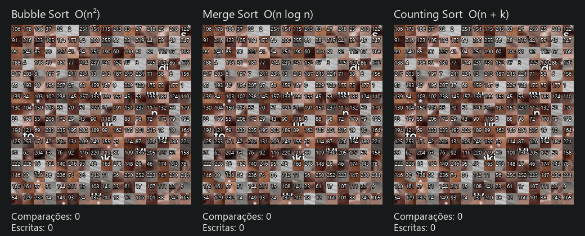

<h1 align="center">Ordenação_Imagem</h1>

<p align="center">
  Demonstração visual de algoritmos de ordenação: uma imagem é cortada em pedaços numerados,<br>
  embaralhada e remontada na tela enquanto cada algoritmo conta suas operações.
</p>

<p align="center">
  
  
  
  
</p>

---

## Demonstração

<p align="center">
  
</p>

Bubble, Merge e Counting Sort ordenando os mesmos 256 pedaços.

---

## Sobre o projeto

**Ordenação_Imagem** é um trabalho da disciplina **Estruturas de Dados 2 (2026.2)** da Universidade de Brasília - FCTE.

A aplicação divide uma imagem em **256 pedaços** (grade 16×16), numera cada pedaço, embaralha e usa um algoritmo de ordenação para colocá-los de volta na ordem certa. Os pedaços **se movem na tela** conforme o algoritmo trabalha, e ao final são exibidas as operações que ele realizou.

Três algoritmos podem ser escolhidos:

- **Bubble Sort - `O(n²)`**
- **Merge Sort - `O(n log n)`**
- **Counting Sort - `O(n + k)`**

Todos ordenam a **mesma lista de números** e usam as mesmas métricas, o que permite comparar:

- número de comparações realizadas;
- número de escritas no vetor;
- o comportamento visual de cada estratégia.

---

## Integrantes

<div align="center">

| [](https://github.com/arthurrochamoreira)<br><nobr><sub style="font-size: 160%;">Arthur Moreira</sub></nobr> | [](https://github.com/dev-LucasDpaula)<br><nobr><sub style="font-size: 160%;">Lucas D. Paula</sub></nobr> |
| :---: | :---: |
| 21/1030658 | 24/1011386 |

</div>

---

## Como funciona

A imagem nunca é ordenada diretamente. Quem ordena são apenas **números**, e a tela apenas reproduz o que o algoritmo fez.

```text
imagem 480×480
      ↓
corte em 16×16 → 256 pedaços de 30×30 px
      ↓
pedaço da posição original k recebe o número k (0 a 255)
      ↓
lista de números embaralhada
      ↓
algoritmo ordena os números e avisa cada escrita
      ↓
a tela move o pedaço de número V até a posição I
      ↓
imagem montada + contadores
```

Cada vez que um algoritmo escreve o valor `V` na posição `I` do vetor, ele avisa por um callback `ao_escrever(I, V)`. Cada comparação é avisada por `ao_comparar()`. A janela guarda esses avisos na ordem em que aconteceram e os reproduz: desliza o pedaço de número `V` até a casa `I` a cada escrita e faz subir o contador a cada comparação.

### Contadores

| Contador | O que mede |
| :--- | :--- |
| **Comparações** | Quantas vezes dois elementos foram comparados entre si |
| **Escritas** | Quantas vezes um valor foi escrito numa posição do vetor |

---

## Algoritmos implementados

| Algoritmo | Complexidade | Compara elementos? | Como escreve no vetor |
| :--- | :---: | :---: | :--- |
| **Bubble Sort** | `O(n²)` | Sim | Trocas de vizinhos (2 escritas por troca) |
| **Merge Sort** | `O(n log n)` | Sim | Cada elemento intercalado volta ao vetor |
| **Counting Sort** | `O(n + k)` | Não | Reescreve o vetor inteiro em ordem |

### Bubble Sort

Percorre o vetor comparando vizinhos e trocando os que estão fora de ordem. A cada passada, o maior elemento da parte ativa chega à sua posição definitiva. Se uma passada termina sem trocas, o algoritmo para.

Além de comparações e escritas, ele também informa `trocas` e `passadas`.

### Merge Sort

Divide o vetor ao meio, ordena cada metade e intercala as duas de volta no vetor. Cada elemento intercalado é uma escrita, mesmo quando já estava no lugar certo.

### Counting Sort

Conta quantas vezes cada valor aparece e reescreve o vetor em ordem, repetindo cada valor pelo número de vezes contado. Aceita números negativos, deslocando os valores pelo menor elemento.

`k` é a diferença entre o maior e o menor valor da lista.

> O Counting Sort **não compara elementos entre si**, então o contador de comparações é sempre `0`. É o comportamento esperado do algoritmo.

---

## Resultados observados

Valores reais obtidos com a lista de 5 pedaços `[3, 0, 4, 1, 2]` e com 256 pedaços:

| Entrada | Algoritmo | Comparações | Escritas |
| :--- | :--- | ---: | ---: |
| `[3, 0, 4, 1, 2]` | Bubble Sort | 9 | 10 |
| | Merge Sort | 8 | 12 |
| | Counting Sort | 0 | 5 |
| 256 pedaços, ordem invertida | Bubble Sort | 32.640 | 65.280 |
| | Merge Sort | 1.024 | 2.048 |
| | Counting Sort | 0 | 256 |
| 256 pedaços embaralhados (`random.Random(7)`) | Bubble Sort | 32.504 | 34.040 |
| | Merge Sort | 1.726 | 2.048 |
| | Counting Sort | 0 | 256 |

Os resultados evidenciam a diferença esperada entre os comportamentos assintóticos:

```text
Bubble Sort   → O(n²)
Merge Sort    → O(n log n)
Counting Sort → O(n + k)
```

> Com a janela, o embaralhamento é aleatório a cada clique em **Embaralhar**, então as contagens do Bubble Sort e do Merge Sort variam um pouco de uma execução para outra.

---

## Como usar

Na janela:

1. Escolha o algoritmo no seletor.
2. Clique em **Embaralhar** para misturar os pedaços.
3. Clique em **Ordenar** para ver os pedaços se movendo.
4. Ajuste a **Velocidade** quando quiser.
5. Os contadores abaixo da imagem sobem durante a animação e mostram o total ao terminar.

---

## Estrutura do projeto

```text
G14_Ordenacao_EDA2-2026.2/
│
├── algoritmos/
│   ├── __init__.py
│   ├── bubble_sort.py
│   ├── merge_sort.py
│   └── counting_sort.py
│
├── assets/
│   ├── nunkiditos.jpg
│   └── execucao.gif
│
├── exemplos/
│   └── demo_bubble.py
│
├── tests/
│   └── test_bubble_sort.py
│
├── ordenacao_imagem.py
├── requirements.txt
├── README.md
└── .gitignore
```

### Responsabilidades principais

| Arquivo | Responsabilidade |
| :--- | :--- |
| `ordenacao_imagem.py` | Corte da imagem, embaralhamento e janela com a animação |
| `algoritmos/__init__.py` | Registro `ALGORITMOS` usado pelo seletor da janela |
| `algoritmos/bubble_sort.py` | Bubble Sort |
| `algoritmos/merge_sort.py` | Merge Sort |
| `algoritmos/counting_sort.py` | Counting Sort |
| `exemplos/demo_bubble.py` | Exemplo em texto do Bubble Sort, sem imagem |
| `tests/test_bubble_sort.py` | Testes do Bubble Sort |

---

## Tecnologias utilizadas

- **Python 3.10+**
- **tkinter** - janela e animação (já vem com o Python)
- **Pillow** - abrir, redimensionar e cortar a imagem

---

## Guia de instalação

### 1. Clone o repositório

```bash
git clone https://github.com/eda2-2026/G14_Ordenacao_EDA2-2026.2.git
cd G14_Ordenacao_EDA2-2026.2
```

### 2. Instale a dependência

```bash
python -m pip install -r requirements.txt
```

### 3. Execute a aplicação

```bash
python ordenacao_imagem.py
```

---

## Conclusões

```text
O(n²)       → Bubble Sort
O(n log n)  → Merge Sort
O(n + k)    → Counting Sort
```

---

## Referências

- **CORMEN, T. H. et al.** *Introduction to Algorithms.* 3rd ed. MIT Press, 2009.
- **Pillow.** Documentação. https://pillow.readthedocs.io

---

<p align="center">
  <sub>Trabalho da disciplina Estruturas de Dados 2 - 2026.2</sub><br>
  <sub>Universidade de Brasília - FCTE</sub>
</p>
